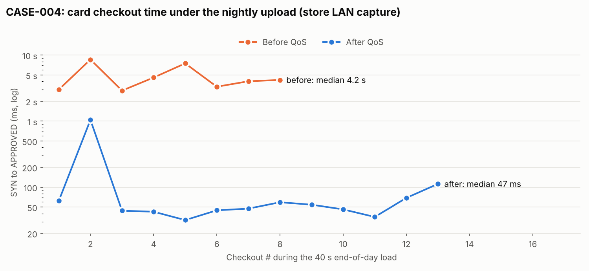
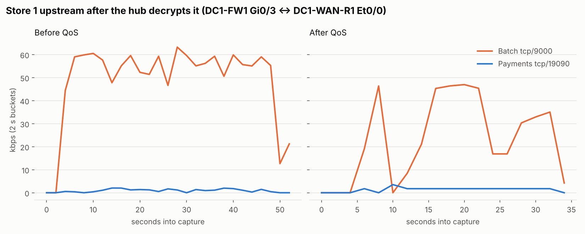

# CASE-004 · Cards Time Out at Closing (QoS)

**Almnjoy Labs · Store 1 Wicker Park · completion pack**: the answer, the proof and the pcaps.

Card payments at Store 1 time out every night when the end-of-day sales upload to HQ starts. The store's uplink is sold as **64 kbps**. The upload fills it and checkouts wait behind it. The fix is QoS on the store router (RTL1-R1) so payments always go first, without killing the upload.

| Same test (`storeload run -t 40`) | Checkouts approved | Median | Worst | Batch upload |
|---|---|---|---|---|
| **Before** (golden, no QoS) | 8/9 (89%) | **4,116 ms** | 8,577 ms | 24.6 kbps |
| **After** (config below) | 20/20 (100%) | **50 ms** | 1,049 ms | 29.5 kbps |

Payments got roughly 80x faster, and **the upload got faster too**. Shaping replaces the ISP's tail drops with your own orderly queue, so TCP stops thrashing.



---

## 1. QoS in five lines

1. **Classify**: decide what a packet is (ACL, port, DSCP).
2. **Mark**: write that answer into the packet (`set dscp`). Do it once, at the door, on the **store LAN inbound**.
3. **Queue**: when the line is full, decide who goes first. That only happens where it is congested, on the **WAN outbound**.
4. **Shape**: rate-limit yourself just under the sold speed, so the queue fills on **your** router (where your rules live) and not in the ISP's.
5. **On the WAN you can't see ports.** By then everything is ESP inside the DMVPN tunnel. The router copies the inner DSCP onto the outer ESP header, so **the WAN policy must match on DSCP, not on ACLs**. That's why you mark first.

> A **class-map** identifies traffic. A **policy-map** defines its treatment. A **service-policy** attaches that policy to an interface, in one direction.

## 2. The answer

Full file: [`configs/RTL1-R1-final-qos.cfg`](configs/RTL1-R1-final-qos.cfg)

```
! 1. CLASSIFY
ip access-list extended PCI-SOURCE
 10 permit tcp host 192.168.100.10 any eq 19090      ! card checkout
ip access-list extended PCI-NIGHTLY
 10 permit tcp host 192.168.100.10 any eq 9000       ! end-of-day batch
class-map match-all PCI-IN
 match access-group name PCI-SOURCE
class-map match-all PCI-LIMIT
 match access-group name PCI-NIGHTLY
!
! 2. MARK at the door (store LAN subinterface, INPUT)
policy-map PCI-IN
 class PCI-IN
  set dscp af21
 class PCI-LIMIT
  set dscp af11
interface Ethernet0/1.100
 service-policy input PCI-IN
!
! 3. QUEUE on the way out (match DSCP: ports are hidden in ESP)
class-map match-all WAN-PAYMENT
 match dscp af21
class-map match-all WAN-ROUTING
 match dscp cs6
class-map match-all WAN-BATCH
 match dscp af11
policy-map WAN-CHILD
 class WAN-PAYMENT
  priority 16
 class WAN-ROUTING
  bandwidth 8
 class WAN-BATCH
  bandwidth 16
 class class-default
  fair-queue
!
! 4. SHAPE under the circuit, nest the queuing policy inside
policy-map WAN-PARENT
 class class-default
  shape average 56000
  service-policy WAN-CHILD
interface Ethernet0/0
 service-policy output WAN-PARENT
end
write memory
```

### Why these numbers

| Where | Command | Value | Why |
|---|---|---|---|
| Parent, Et0/0 out | `shape average` | **56000** | The circuit is 64 kbps. Shaping at about 87% keeps the queue on RTL1-R1. At 64k or above, the ISP's queue fills first and your rules never fire |
| Payments (AF21) | `priority` | **16** kbps | Low-latency queue: payments jump the line. One checkout is about 360 bytes in 6 packets, roughly 2 to 3 kbps with ESP overhead, so 16 is plenty. During congestion it is also capped at 16 by an implicit policer |
| Routing (CS6) | `bandwidth` | **8** kbps | EIGRP hellos over Tunnel0. If they starve, the tunnel drops and everything dies. The router marks them CS6 itself |
| Batch (AF11) | `bandwidth` | **16** kbps | A guaranteed *minimum*. Batch still uses all spare capacity. It just goes last when the line is busy |
| Everything else | `fair-queue` | n/a | Shares what's left fairly |
| Budget check | n/a | 16+8+16 = 40 of 56 (71%) | IOS rejects reservations over about 75% of the parent rate |

**`bandwidth` is a floor, `police` is a ceiling.** A policer drops traffic even when the line is idle, so you don't police the batch here. CASE-005 is where you police: there, a vendor agent you are told to cap.

### DSCP cheat sheet

| Name | Decimal | ToS byte (hex) | Typical use | Here |
|---|---|---|---|---|
| EF | 46 | 0xB8 | Voice | n/a |
| AF41 | 34 | 0x88 | Interactive video | n/a |
| AF31 | 26 | 0x68 | Streaming / mission-critical | was the first pick for batch (wrong job) |
| **AF21** | **18** | **0x48** | **Transactional data** | **card checkout** |
| **AF11** | **10** | **0x28** | **Bulk data** | **end-of-day batch** |
| CS6 | 48 | 0xC0 | Routing protocols | EIGRP over the tunnel |
| Default / BE | 0 | 0x00 | Everything else | unmarked |

DSCP is just a label. It does nothing until a policy somewhere matches it and acts on it.

## 3. Prove it on the router

Run `storeload run -t 40` on RTL1-REG1 (batch and checkouts together), then on RTL1-R1:

```
show policy-map interface Ethernet0/1.100 input     ! marking: PCI-IN and PCI-LIMIT "Packets marked" climb
show policy-map interface Ethernet0/0 output        ! queuing: WAN-PAYMENT "Priority: 16 kbps", packets climb
show running-config | section policy-map|class-map
show startup-config | include service-policy         ! saved?
```

| You see | It means |
|---|---|
| PCI-LIMIT stays at 0 packets | The batch ACL doesn't match (name typo, IP typo) |
| LAN marks climb, WAN-PAYMENT stays at 0 | DSCP isn't surviving to Et0/0. Check `tunnel tos` on Tunnel0 |
| WAN-BATCH shows drops | **Correct.** Batch waits so payments don't |
| Checkouts still slow, router counters clean | Shaper at or above 64k. The queue moved back to the ISP |

## 4. The packet captures

Three capture points along the path, taken before (golden) and after (QoS), during the same `storeload run -t 40`.

```
RTL1-REG1 ── RTL1-SW1 ══P1══ RTL1-R1 ── ISP-A (64 kbps) ── DC1-WAN-R1 (hub) ══P2══ DC1-FW1 ── ... ── ACC-SW1 ══P3══ PAY-SRV1
 register     802.1Q trunk   marks + queues   ESP only          decrypts          ESP + inner       HQ campus     10.1.40.10
```

| File | Point | Before: checkout median / worst | After: median / worst | TCP retrans on 19090 (before → after) |
|---|---|---|---|---|
| `P1-store-LAN_RTL1-R1-Et0-1.pcap` | Store LAN trunk (VLAN 100) | 4,112 / 8,573 ms | 47 / 1,045 ms | 33 → 1 |
| `P2-hub-link_DC1-FW1-Gi0-3.pcap` | Hub ↔ DC firewall | 2,066 / 3,595 ms | 37 / 52 ms | 40 → 0 |
| `P3-server_PAY-SRV1-eth0.pcap` | Payment server port | 2,055 / 3,586 ms | 26 / 43 ms | 40 → 0 |

*Checkout time = first SYN to the server's APPROVED reply, measured inside each capture.*



### What the captures prove

**1. P1 shows DSCP 0, even after the fix. That's correct.**
The marking policy runs *inbound* on Et0/1.100, so it marks the packet after it has crossed the wire you're capturing. The register sends everything unmarked (`storeload` runs with marking OFF). On P1 the payments show as the white/blue *"Payment NOT marked yet"* coloring rule. To see marks, look downstream of the router: P2 or P3.

**2. P2 is the money shot: the DSCP rides on the encrypted packet.**
This link carries the ESP packets *and* the same packets after the hub decrypts them. Filter `esp && ip.dsfield.dscp == 18` and then `tcp.dstport == 19090 && ip.dsfield.dscp == 18`:

| P2 after | ESP outer header | Decrypted inner |
|---|---|---|
| AF21 (payments) | **84 packets** | **84 packets** |
| AF11 (batch) | 192 | 129 |
| CS6 (EIGRP) | 29 | 14 hellos |

84 = 84: every marked checkout packet had AF21 copied onto its outer ESP header. That's the only reason the WAN class can match it at all. Before the fix, every ESP packet is DSCP 0 except CS6 (routing).

**3. The delay happens between P1 and P2, at the 64 kbps circuit.**
Before the fix, P1 says checkouts took 4.1 s but P2 and P3 say 2.1 s. The difference is **SYN retries**: the register's first SYNs were dropped in the ISP's full queue and never reached the hub. Use the *Checkout SYNs* button on the before P1 capture:

```
stream 5: SYN at 10.8 11.8 12.9 13.9 14.9 s   (5 tries)
stream 11: SYN at 26.9 27.9 28.9 s             (3 tries)
```

After the fix, every checkout gets in on its first SYN, except one at 1,045 ms. That was one dropped SYN and one retry, the only slow one in the after run.

**4. Replies are unmarked, and that's fine.**
Server-to-register traffic (`tcp.srcport == 19090`) is DSCP 0 everywhere. You only marked inbound on the store LAN, and the bottleneck is the store's *upstream*. Marking the return path would be a policy at HQ, which is a different change.

**5. The upload wasn't hurt.**
Batch upload went from 24.6 to 29.5 kbps (storeload's own number). Without QoS, TCP kept hitting tail drops at the ISP and backing off. With the shaper, drops happen in your WAN-BATCH queue in a controlled way.

## 5. Wireshark: profile, buttons, views

**Import the profile:** Edit → Configuration Profiles → **Import** → *from zip file* → `wireshark/ALMNJOY-QoS-profile.zip`. Then switch to **ALMNJOY-QoS** (bottom-right of the status bar). The unzipped files are in `wireshark/ALMNJOY-QoS/` if you'd rather copy them by hand.

**Columns:** No. · Time · **VLAN** · Source · Destination · Proto · **DSCP** · Sport · Dport · **Stream** · Len · Info

**Coloring (first match wins):**

| Color | Rule |
|---|---|
| Red | TCP retransmission / lost segment / dup ACK |
| Dark red | TCP reset |
| Blue | AF21 payment (marked) |
| Orange | AF11 batch (marked) |
| Purple | CS6 routing |
| Blue text | Payment *not marked yet* |
| Orange text | Batch *not marked yet* |
| Gray | ESP unmarked |
| Faded | L2 noise (STP, LLDP, CDP, loop, ARP, DHCP) |

**Filter buttons:** Payments · Batch · Checkout SYNs · Approvals · AF21 · AF11 · CS6 · ESP · ESP AF21 · TCP trouble · No noise

### Views worth knowing

| View | Menu | Use it for |
|---|---|---|
| Packet details | expand **Internet Protocol → Differentiated Services Field** | The DSCP bits on one packet (AF21 = 0x48 in the ToS byte) |
| I/O Graph | Statistics → **I/O Graphs** | Add one graph per filter: `tcp.port==19090`, `tcp.port==9000`. Y axis Bits/s, interval 1 s. Recreates the chart above |
| Conversations | Statistics → **Conversations** → TCP | One row per checkout, with bytes and duration. Sort by Duration: before, every checkout lasts seconds |
| Expert Info | Analyze → **Expert Information** | Retransmission and dup ACK counts at a glance. Compare before vs after |
| Flow Graph | Statistics → **Flow Graph**, "Limit to display filter" with `tcp.stream == 5` | Ladder diagram of one checkout: SYN, SYN, SYN... finally SYN-ACK |
| TCP Stream Graph | Statistics → TCP Stream Graphs → **Round Trip Time** | RTT for one checkout stream. Before: seconds. After: tens of ms |
| Follow stream | right-click → Follow → **TCP Stream** | See the checkout JSON and the `APPROVED` reply |
| Protocol Hierarchy | Statistics → **Protocol Hierarchy** | On P2: how much is ESP vs decrypted TCP |

The same views from the command line (tshark):

```
tshark -r P2.pcap -Y "esp && ip.dsfield.dscp==18" | wc -l          # marked ESP
tshark -r P2.pcap -q -z conv,tcp                                      # conversations
tshark -r P1.pcap -q -z expert                                        # expert info
tshark -r P2.pcap -q -z io,stat,1,"tcp.port==19090","tcp.port==9000"  # I/O per second
tshark -r P2.pcap -q -z io,phs                                        # protocol hierarchy
```

## 6. What tripped me up (and the straight answer)

| Snag | Answer |
|---|---|
| Payments on 8088 or 19090? | **19090** is PumpLine checkout. 8088 is the register's screen for the Lab Browser. Both are in the case's *Network → Key flows* table. Tom didn't know, and that's realistic |
| Policy on `Ethernet0/1` | The register's IP lives on **Ethernet0/1.100** (VLAN 100). Put the input policy on the subinterface |
| Which DSCP? | AF21 for transactional (checkout), AF11 for bulk (batch). See the cheat sheet above |
| "I can't see the tag in my pcap" | You captured P1, which is before the router marks. Look at P2 or P3 |
| `priority` rejected | `priority` (and `bandwidth`, `shape`) only work in an **output** policy. Input policies classify, mark and police |
| Batch class matched nothing | ACL named `PCI-NIGHLY` vs class-map `PCI-NIGHTLY`, plus `host 19.168.100.10`. Two typos, zero matches |
| "Limit the upload" | `bandwidth` is a minimum, not a limit. Use `police` for a hard cap, which this case doesn't want |
| What rates? | Shape 56000, priority 16, bandwidth 8 (routing) and 16 (batch). See *Why these numbers* |
| Mixed bandwidth types | IOS won't mix `bandwidth <kbps>` and `bandwidth remaining percent` in one policy-map. Pick one style |

## 7. How it went (from command accounting)

| Time (CST) | Step |
|---|---|
| 08:30 | First class-map/ACL for 19090. Policy attached on Et0/1 (physical) |
| 08:53 | Moved the input policy to **Et0/1.100** |
| 11:01 | `set dscp af21` on payments. Counters climb, but no tag in the P1 pcap (see 4.1) |
| 11:20 | Batch ACL + class (with two typos), `af31` |
| 11:38 | `priority 9 32` in the input policy: rejected (output-only) |
| 11:42 | Typos fixed, batch → AF11, WAN classes on DSCP |
| 11:43 | WAN-CHILD (LLQ) + WAN-PARENT (shape 56k) on Et0/0 out, `write memory` |
| 11:50 | After test: 20/20, median 50 ms. After pcaps taken |
| 12:01 | Reset to golden. Before test: 8/9, median 4.1 s. Before pcaps taken |

## 8. Analyzer reports

Each capture point, before vs after, run through the Almnjoy Labs Packet Analyzer with the question *"Card checkouts on port 19090 time out when the end-of-day batch on port 9000 runs. Did QoS fix it?"*

| Point | Report | Checkout p95 before -> after | Data resent on 19090 | Data resent on 9000 (batch) |
|---|---|---|---|---|
| P1 store LAN | [PDF](analysis/P1-store-LAN_RTL1-R1-Et0-1.before-vs-after.pdf) · [HTML](analysis/P1-store-LAN_RTL1-R1-Et0-1.before-vs-after.html) | 4,211 ms -> 36 ms | 37.0% -> 0% | 41.5% -> 23.2% |
| P2 hub link | [PDF](analysis/P2-hub-link_DC1-FW1-Gi0-3.before-vs-after.pdf) · [HTML](analysis/P2-hub-link_DC1-FW1-Gi0-3.before-vs-after.html) | 4,922 ms -> 26 ms | 33.3% -> 0% | 43.5% -> 24.2% |
| P3 server | [PDF](analysis/P3-server_PAY-SRV1-eth0.before-vs-after.pdf) · [HTML](analysis/P3-server_PAY-SRV1-eth0.before-vs-after.html) | 4,921 ms -> 27 ms | 33.3% -> 0% | 37.5% -> 24.3% |

The analyzer's checkout time starts at the **first request byte**, not the first SYN, so it leaves out the SYN retries that section 4 counts (that is why P1's worst case reads lower here than the 8.6 s in the table above). The batch still resends about a quarter of its data after the fix: that is WAN-BATCH dropping in your queue on purpose so payments go first, and the reports still flag it.

## Files

```
CASE-004-QoS/
├── README.md                       this page
├── configs/RTL1-R1-final-qos.cfg   the answer, annotated
├── logs/storeload-{before,after}.txt
├── pcaps/before/P1|P2|P3 *.pcap    golden, no QoS
├── pcaps/after/P1|P2|P3 *.pcap     with the config above
├── img/*.png                       charts on this page
├── analysis/P1|P2|P3 *.pdf|.html   analyzer before/after reports
└── wireshark/
    ├── ALMNJOY-QoS-profile.zip     import this
    └── ALMNJOY-QoS/                same profile, unzipped
```

*Lab: Almnjoy Labs ALMNJOY-ENT on Cisco Modeling Labs (IOL, IOSv, ASAv). All addresses are lab-only.*
