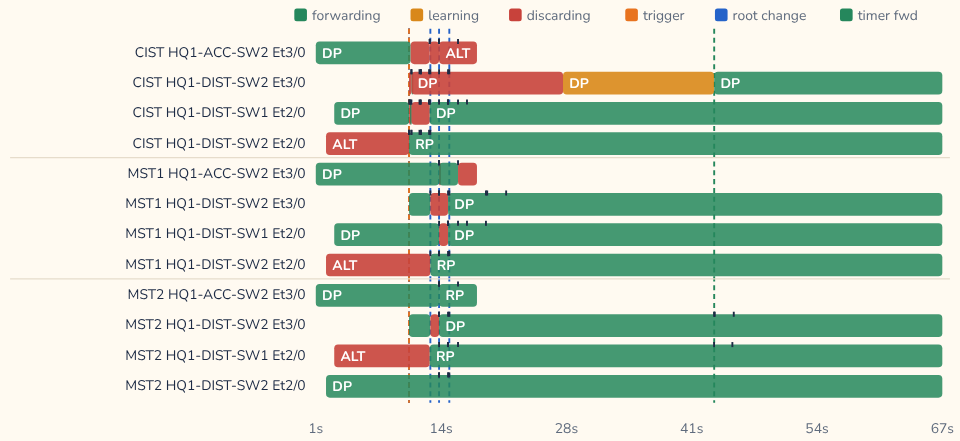

# CASE-008 · Spanning Tree (MST root move)

**Almnjoy Labs · HQ1 campus · capture pack**: four captures of one change, and what they prove.

HQ1-ACC-SW2, an access switch, was root of every spanning tree at priority 4096. That is the classic mistake: nobody set the root, so the wrong switch won. The fix raises ACC-SW2's MST priority so the distribution pair takes over, each one rooting the instance whose gateway it holds:

| Instance | VLANs | Intended root |
|---|---|---|
| MST1 | 1, 10, 20 | HQ1-DIST-SW1 |
| MST2 | 30, 40 | HQ1-DIST-SW2 |



*Green = forwarding, amber = learning, red = discarding. Orange line = the trigger, blue lines = every switch agreeing on a new root, green dashed = a port reaching forwarding on timers.*

## The captures

All four were running at the same time, one per member of the two port-channels between the switches.

| File | Link | Bundle | Carries |
|---|---|---|---|
| `P1-Po3-Et2-0_DIST-SW1-DIST-SW2.pcap` | DIST-SW1 Et2/0 <-> DIST-SW2 Et2/0 | Po3 | BPDUs, LACP, CDP/LLDP, HSRP |
| `P2-Po3-Et2-1_DIST-SW1-DIST-SW2.pcap` | DIST-SW1 Et2/1 <-> DIST-SW2 Et2/1 | Po3 | LACP, CDP/LLDP, HSRP, **no BPDUs** |
| `P3-Po2-Et3-0_ACC-SW2-DIST-SW2.pcap` | ACC-SW2 Et3/0 <-> DIST-SW2 Et3/0 | Po2 | BPDUs, LACP, CDP/LLDP, HSRP |
| `P4-Po2-Et3-1_ACC-SW2-DIST-SW2.pcap` | ACC-SW2 Et3/1 <-> DIST-SW2 Et3/1 | Po2 | LACP, CDP/LLDP, HSRP, **no BPDUs** |

**Why half the files have no spanning tree:** IOS sends a port-channel's BPDUs on one member only. Capture every member if you want to see LACP on all of them; capture the first member if you want the tree.

## What happened (clock in CST, from the BPDUs)

| Time | Event |
|---|---|
| 11:27:12.516 | ACC-SW2 starts advertising its own priority 32768 (was 4096) in CIST, MST1 and MST2. **The trigger.** |
| 11:27:12.519 | Topology-change flags go up in all three trees |
| 11:27:14.763 | Every switch agrees: CIST root = DIST-SW1 (24576), 2.25 s after the trigger |
| 11:27:15.684 | MST2 root = DIST-SW2 (24576), 3.17 s |
| 11:27:16.763 | MST1 root = DIST-SW1 (24576), 4.25 s |
| 11:27:44.706 | DIST-SW2 Et3/0 (CIST) finally reaches Forwarding, raising a second, smaller TC burst in MST2 |

### Where blocking sat
| | Blocked ports |
|---|---|
| **Before** | DIST-SW2 Et2/0 blocks CIST + MST1, DIST-SW1 Et2/0 blocks MST2. The DIST-DIST link (Po3) carried half of each tree. |
| **After** | ACC-SW2 Et3/0 blocks CIST + MST1. Po3 forwards both instances, which is what you want between the gateways. |

### The straggler: 30 seconds on timers
DIST-SW2's designated port toward ACC-SW2 (Et3/0) proposed for CIST and never got an agreement back, because ACC-SW2's side had just gone Alternate. With no handshake, RSTP falls back to the old 802.1D timers: **Discarding about 16 s, Learning about 16 s, Forwarding at 11:27:44.706** (2 x forward delay). That moment is the second TC burst. Nothing in these captures is unexplained.

### Everything else checked
- **MST region:** name `TheMain`, revision 1, same VLAN-map digest from all three bridges. One region.
- **HSRP v2:** DIST-SW1 is active gateway for VLAN 1, 10, 20; DIST-SW2 for VLAN 30. That lines up with the MST1 / MST2 roots, which is the point of the design.
- **LACP:** Po3 active/active, Po2 DIST-SW2 active / ACC-SW2 passive, slow rate (30 s), every member in sync, collecting and distributing.
- **DTP** is still negotiating on these trunks. Harmless in a lab; hard-set trunks with `switchport nonegotiate` in production.

## Wireshark filters for this case

| What | Filter |
|---|---|
| Every BPDU | `stp` |
| The trigger (ACC-SW2's own bridge ID) | `mstp.cist_bridge.hw == aa:bb:cc:00:0d:00` |
| Topology-change flags | `stp.flags.tc == 1` |
| Who claims root, per instance | add columns `stp.root.hw`, `mstp.msti.msti_id`, `mstp.msti.root.hw` |
| Alternate (blocked) ports | `stp.flags.port_role == 1` |
| LACP state | `lacp` (columns `lacp.actor.state`, `lacp.partner.state`) |
| HSRP active hellos | `hsrp2.state == 6` |

## Analyzer report
[`analysis/CASE-008-mst-root-move.4-links.pdf`](analysis/CASE-008-mst-root-move.4-links.pdf) (HTML version alongside). All four captures merged onto one clock; links are named from CDP. It has the root table, port roles start vs end, TC windows with what raised each, LACP and HSRP tables, and the timeline chart above.

## Prove it on the switches
```
show spanning-tree root
show spanning-tree mst 1
show spanning-tree mst 2
show spanning-tree mst configuration
show spanning-tree detail | i ieee|occurr|from|is exec
show etherchannel summary
show standby brief
```

## Files
```
CASE-008-STP/
├── README.md
├── pcaps/P1..P4 *.pcap          one per port-channel member
├── analysis/*.pdf, *.html       analyzer report, 4 links merged
└── img/port-roles-over-time.png
```

*Lab: Almnjoy Labs ALMNJOY-ENT on Cisco Modeling Labs (IOL L2). All addresses and MACs are lab-only.*
