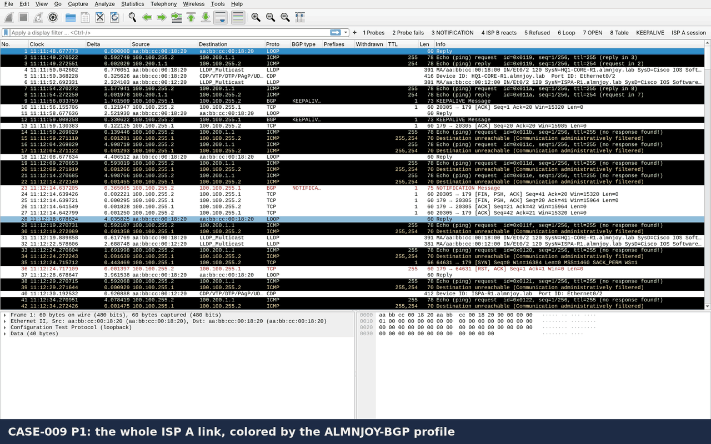
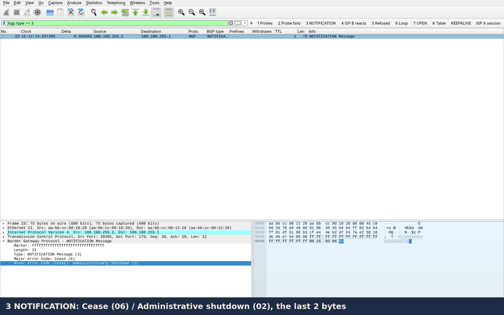
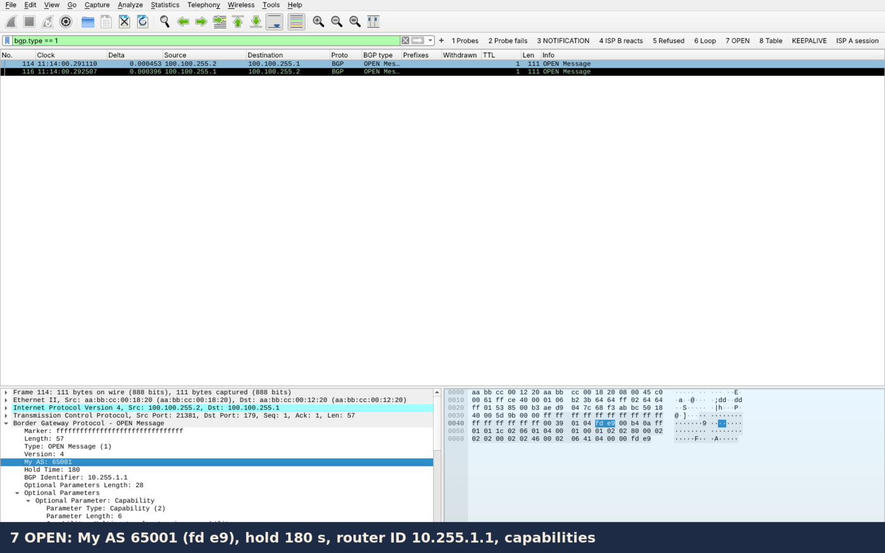
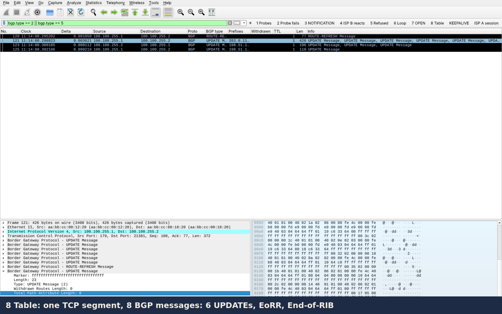

# CASE-009 · ISP A Is About to Shut the Session (BGP + IP SLA)

**Almnjoy Labs · HQ1 edge · teaching pack**: one full cycle of the HQ edge, captured on the wire and in the router's own show commands. Steady state, ISP A goes soft, the IP SLA notices, EEM shuts the ISP A neighbor, ISP A keeps knocking, ISP A heals, the session comes back with a full OPEN and table exchange. The point is to see every BGP message and what it carries.

HQ (AS 65001) is dual-homed. HQ1-CORE-R1 peers with ISP A (AS 65100) and HQ1-CORE-R2 peers with ISP B (AS 65200). The case's fix adds IP SLA 10 on R1 (echo to 100.200.1.1 every 5 s), track 10 on it (`delay down 10 up 30`) and two EEM applets: ISPA-SOFT-DOWN shuts the ISP A neighbor, ISPA-SOFT-UP brings it back. The soft failure is an inbound ACL on ISPA-R1 Et0/2. The link and the BGP session stay up, but traffic through ISP A stops.

## The captures (2026-11-25, 11:11:48 to 11:14:30 CST)

One capture per link, taken on the HQ side, the way you would capture a real ISP handoff: one tap or SPAN on your own edge port.

| File | Link (captured on) | Frames |
|---|---|---|
| `pcaps/P1-ISPA-link_HQ1-CORE-R1-Et0-2.pcap` | HQ1-CORE-R1 Et0/2, facing ISPA-R1 | 143 |
| `pcaps/P2-ISPB-link_HQ1-CORE-R2-Et0-2.pcap` | HQ1-CORE-R2 Et0/2, facing ISPB-R1 | 73 |

**Open P1 first** (the whole ISP A story), then P2 (what ISP B did meanwhile). The two files run on the same clock, so the analyzer lays them on one timeline.

`logs/` has HQ1-CORE-R1's show commands (track 10, IP SLA 10 statistics, BGP summary, the BGP and EEM log lines, the default route) taken **before**, **during** and **after** the break. `pcaps/2026-11-23-first-run/` is the first capture of this case (same two links), which stopped before the recovery.

## What happened (clock in CST)

| Time | Event | Wireshark filter |
|---|---|---|
| 11:11:49 to 11:11:54 | IP SLA 10 echoes to 100.200.1.1 answered. Default route is BGP via ISP A (`logs/..._1-before.txt`). | `icmp && ip.addr == 100.200.1.1` |
| 11:11:56.033 | KEEPALIVE ISPA-R1 -> R1; 11:11:59.008 KEEPALIVE R1 -> ISPA-R1. Steady state. | `bgp.type == 4` |
| **11:11:59.269** | **First failed probe.** ISPA-R1 answers with ICMP 3/13, *communication administratively prohibited* (the ACL). | `icmp.type == 3 && icmp.code == 13` |
| **11:12:14.637** | **R1 sends NOTIFICATION Cease / Administrative shutdown** to ISPA-R1, 15.4 s after the first failure, then closes TCP (FIN both ways). Router log: `NBR_RESET ... (Admin. shutdown)` at 11:12:14.636, EEM `ISPA-SOFT-DOWN` at 11:12:14.743. | `bgp.type == 3` |
| 11:12:14.644 | ISPB-R1 sends R2 an UPDATE for 198.51.100.0/25, AS_PATH 65200 65100 65001. | `bgp.type == 2 && ip.addr == 100.200.255.1` |
| 11:12:24.715 to 11:13:56.892 | ISPA-R1 tries to reconnect 9 times. Every SYN to R1's port 179 gets a RST: R1 is up, the neighbor is shut. | `tcp.port == 179 && tcp.flags.reset == 1` |
| 11:12:44.741 | ISPB-R1 withdraws 198.51.100.0/25. | `bgp.update.withdrawn_routes.length > 0` |
| 11:13:17.714 to 11:13:49.770 | **Forwarding loop.** 9 packets from 34.107.243.93 to 198.51.100.10 come in from ISP B with TTL 115. About 64 ms later 198.51.100.140 answers TTL-exceeded, quoting TTL 1. See below. | `icmp.type == 11 \|\| ip.dst == 198.51.100.10` |
| **11:13:24.270** | **Probes answered again** (the ACL is gone). Track 10 now waits its `delay up 30`. | `icmp.type == 0` |
| **11:14:00.288** | **R1 opens TCP to ISPA-R1 and it is accepted**: SYN, SYN-ACK, ACK. | `tcp.port == 179 && tcp.flags.syn == 1` |
| 11:14:00.291 | **OPEN** R1 -> ISPA-R1, 11:14:00.292 OPEN back, then a KEEPALIVE each way to confirm. Session down 105.7 s in total. | `bgp.type == 1` |
| 11:14:00.295 to 11:14:00.302 | ROUTE-REFRESH **BoRR**, ISP A's table (6 UPDATEs), ROUTE-REFRESH **EoRR**, **End-of-RIB**; R1's table (2 UPDATEs) and its End-of-RIB. | `bgp.type == 2 \|\| bgp.type == 5` |
| 11:14:00.304 | ISPB-R1 sends R2 198.51.100.0/25 again (AS_PATH 65200 65100 65001). | `bgp.type == 2 && ip.addr == 100.200.255.1` |
| ~11:13:58 (show) | `show ip route 0.0.0.0` in `_3-after.txt`: default back via BGP from 100.100.255.1, "00:00:00 ago". | (router) |

Probe tally on the wire: 15 answered, 17 refused.

**Why 15.4 s from first failure to NOTIFICATION:** the track waits `delay down 10`, and the IP SLA only reports on its 5 s ticks. **Why 36 s from the first good probe to the SYN:** `delay up 30`, plus the next probe tick. The show output in `_3-after.txt` catches the track at "Down, delayed Up (1 sec remaining)" a moment before the session came back.

## Packet by packet: what to look at

The report decodes one example of each kind of message, field by field, with a plain-English note per field and the bytes. In the HTML, click a field to light up its bytes.

- **KEEPALIVE (19 bytes).** Only the common header: 16 bytes of `ff`, length `00 13`, type `04`. No body. It just restarts the peer's hold timer.
- **OPEN (57 bytes here).**
  - Header fields:
    - Version `04`.
    - My AS `fd e9` (65001).
    - Hold Time `00 b4` (180 s; both sides use the lower value, keepalives every third of it).
    - BGP Identifier `0a ff 01 01` (10.255.1.1).
  - Then 28 bytes of capabilities. Each one is type 2 (Capability) with a code:
    - **1**: multiprotocol, IPv4 unicast.
    - **128**: route refresh, the old Cisco code.
    - **2**: route refresh, standard.
    - **70**: enhanced route refresh.
    - **65**: 4-byte AS. It carries the real AS again: `00 00 fd e9`.
  - ISPA-R1's OPEN carries the same five, with AS 65100 and router ID 100.100.254.1.
- **ROUTE-REFRESH (23 bytes).** AFI 1 (IPv4), SAFI 1 (unicast) and a subtype: **1 = BoRR** (Beginning of Route Refresh) and **2 = EoRR** (End). Enhanced route refresh brackets the resend so the receiver knows when it is complete and can drop anything that was not refreshed.
- **UPDATE.** Withdrawn-routes length, path attributes (ORIGIN, AS_PATH, NEXT_HOP, sometimes MED), then the prefixes (NLRI). Read the AS_PATH left to right: leftmost is the neighbor that sent it, rightmost is where the route started. In ISP A's burst:
  - 203.0.113.0/24: `65100 65002`.
  - 0.0.0.0/0 and 100.100.0.0/16: `65100`.
  - 100.200.0.0/16: `65100 65200`.
- **Prepending, visible on the wire.** R1 sends ISP A 198.51.100.128/25 with AS_PATH `65001 65001 65001 65001`, and 198.51.100.0/25 + /24 with just `65001`. HQ makes its .128/25 look 3 hops longer through ISP A, so the internet prefers ISP B for it. ISP A's UPDATE for 198.51.100.0/25 shows the mirror image: `65100 65200 65001 65001 65001 65001`, HQ's prepend done towards ISP B.
- **End-of-RIB.** An UPDATE with nothing in it: withdrawn length 0, attribute length 0. It means "that was my whole table". Both sides send one.
- **Several messages in one segment.** Frame 121 is one TCP segment carrying 8 BGP messages: 6 UPDATEs, the ROUTE-REFRESH EoRR and an End-of-RIB. Wireshark's `bgp.type == 2` matches **frames**: on P1 it shows 3 frames, but there are 11 UPDATE messages inside them.
- **NOTIFICATION (21 bytes).** Header plus major `06` (Cease) and minor `02` (Administrative shutdown): the on-wire form of `neighbor 100.100.255.1 shutdown`, typed here by the EEM applet.
- **SYN / RST / SYN-ACK on 179.** BGP is TCP. ISP A's connect-retry SYNs, every 8 to 15 s, get a RST. The one R1 sends itself at 11:14:00.288 gets a SYN-ACK, and the OPEN follows 3 ms later.
- **ICMP 3/13.** The ACL's "no". It quotes the first bytes of the probe it refused, so you can match each error to its ping.
- **ICMP 11 (TTL exceeded).** Quotes the dying packet's IP header with TTL 1. Compare with the same packet's TTL when it crossed this wire (115). The difference is how many hops it looped.

## The loop (an actual finding, not a teaching prop)

While ISP A was down, return traffic for **198.51.100.10** (a TCP session from 34.107.243.93:443 trying to close with FIN) came in from ISP B to HQ1-CORE-R2 with TTL 115. About 64 ms later, **198.51.100.140** sent back TTL-exceeded quoting TTL 1. So each copy went round about **114 more hops inside HQ** before it died, and the far end kept resending its FIN (9 times, 11:13:17 to 11:13:49). The capture only sees it enter and the error leave. The loop itself is inside HQ.

What fits the logs: during the break R1's default route is OSPF via R2 (`_2-during.txt`), and 198.51.100.10 sits in the ISP A-facing block. If R2 sends traffic for it towards R1 and R1 sends it back towards its default, it ping-pongs until TTL runs out. Chase it in the lab, during a break:
- `show ip route 198.51.100.10` on R1 and R2
- `traceroute 198.51.100.10 source <R2 Et0/2>`
- where NAT for 198.51.100.0/25 lives
- whether a `Null0` route for the block (or keeping it on R1 only) stops the loop

## On your own in Wireshark

*Real Wireshark 4.2 with the ALMNJOY-BGP profile, clicking the filter buttons. The highlighted field's bytes light up in the byte pane.*

| NOTIFICATION: minor code 02 selected | OPEN: My AS `fd e9` selected | Frame 121: 8 BGP messages, End-of-RIB selected |
|---|---|---|
|  |  |  |

1. Import `wireshark/ALMNJOY-BGP-profile.zip` (Edit > Configuration Profiles > Import from zip) and switch to **ALMNJOY-BGP**. The columns show clock time, the BGP type of every message in the segment, prefixes, withdrawn prefixes and TTL. Colors: NOTIFICATION red, OPEN green, UPDATE blue, End-of-RIB pale blue, ROUTE-REFRESH purple, TTL-exceeded orange.
2. Open **P1**. Click the buttons in order:
   - **1 Probes**
   - **2 Probe fails**
   - **3 NOTIFICATION**
   - **5 Refused**
   - **7 OPEN**
   - **8 Table**

   That is the whole ISP A story in six clicks.
3. On the NOTIFICATION, expand Border Gateway Protocol and click "Minor error Code": the status bar shows the field name and the byte `02` lights up.
4. On frame 121, expand BGP: 8 messages in one segment. Right-click an AS_PATH segment > Apply as Column to compare paths.
5. Click **ISP A session**, then **Statistics > Flow Graph** limited to displayed packets: a ladder of the session going down and coming back.
6. Open **P2** and click **4 ISP B reacts**, then **6 Loop**. The FINs arrive with TTL 115; each TTL-exceeded (expand ICMP > the quoted IP header) shows TTL 1.
7. **Statistics > I/O Graph** with `icmp.type == 0` and `icmp.type == 3` as two lines: no echo replies from 11:11:54 to 11:13:24, unreachables in between.

## What AI adds

- **Two links, one timeline.** The analyzer lays P1 and P2 on one clock, names the routers from CDP, and shows ISP B reacting 7 ms after R1's NOTIFICATION on the other link.
- **Messages, not frames.** It split frame 121 into its 8 BGP messages, found the End-of-RIB markers and the BoRR/EoRR bracket, and grouped the table exchange into one finding.
- **Cause and effect across protocols.** It puts these together without being told they are related:
  - first failed probe at 11:11:59.269
  - NOTIFICATION 15.4 s later
  - session back after 105.7 s down
- **The loop.** It matched each TTL-exceeded to the packet it quotes, saw that packet cross with TTL 115, and called it a loop past the capture point instead of a traceroute. That is easy to miss by eye in a BGP capture.
- **Plain English per field**, including what each capability code and the route-refresh subtypes mean.
- **Where a human still looks.** All three need the configs and a few show commands:
  - Why the probe failures show as ICMP 3/13 on the wire but `Latest operation return code: Timeout` in `show ip sla statistics`.
  - Why ISP B briefly offers HQ its own /25 back.
  - The loop.

## What these captures do NOT show

- **Inside HQ.** The loop and the failover of user traffic happen between R1, R2 and whatever sits behind them. Capture R1 Et0/0 and Et0/1 next time to see the loop itself.
- **User traffic moving to ISP B.** Only the TTL-exceeded FINs hint at it. A host pinging out during the break would show the shift.
- **A silent failure.** The lab ACL still answers with unreachables, so R1 gets an explicit "no". A real soft failure is usually silent. The IP SLA reacts the same either way (the router even calls it a Timeout).
- **ISP B's own reasons.** Why ISPB-R1 sends 198.51.100.0/25 with 65001 at the end of the path at 11:12:14 and 11:14:00, and withdraws it at 11:12:44. R2 drops it on AS_PATH loop prevention. Check `show ip bgp 198.51.100.0` on both ISPs before and after.

## Analyzer report

[`analysis/CASE-009-bgp-full-process.pdf`](analysis/CASE-009-bgp-full-process.pdf) (and the interactive `.html`: click a field to light up its bytes). The question asked, with "when it happened" set to 11:11:59:

> Break down the individual BGP messages (OPEN, KEEPALIVE, UPDATE, NOTIFICATION, ROUTE-REFRESH) and the IP SLA pings, before, during and after the ISP A failure. Show what we can see in each packet.

**AI export:** [`analysis/CASE-009-ai-export.md`](analysis/CASE-009-ai-export.md) is the same analysis as one markdown file to hand to ChatGPT or Claude. How well they did with it: [`analysis/ai-check.md`](analysis/ai-check.md).

The first run (2026-11-23, failure only, no recovery) is kept in `pcaps/2026-11-23-first-run/` and `analysis/2026-11-23-first-run/`.
